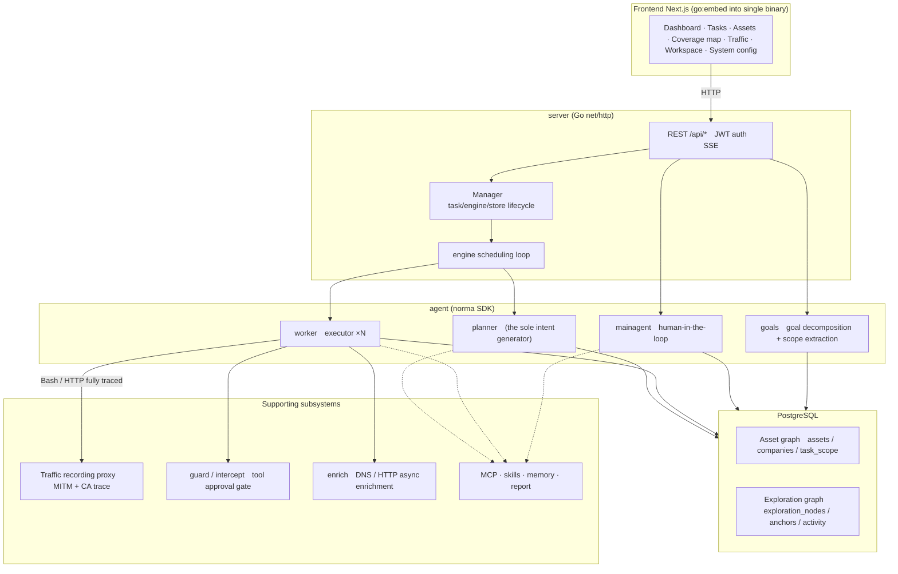
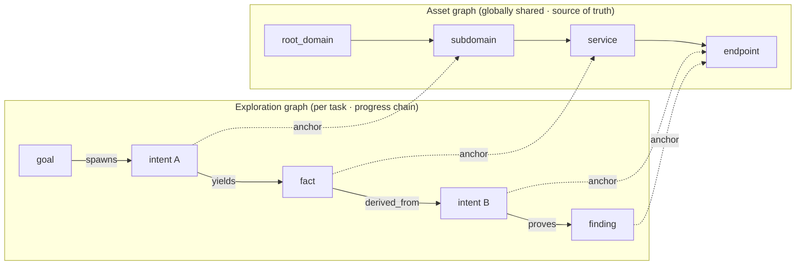
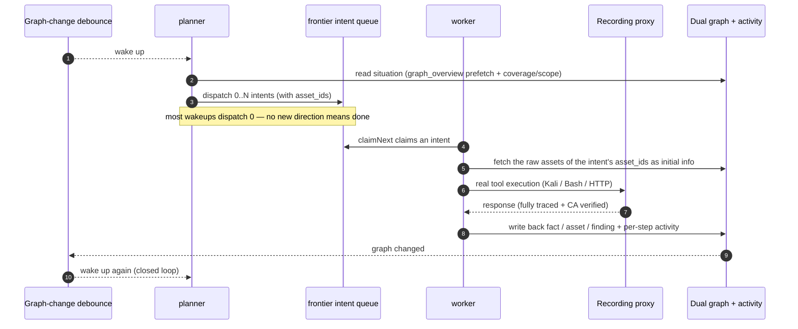
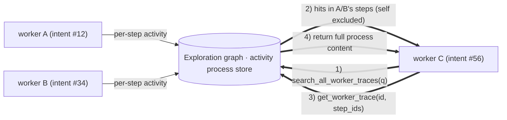
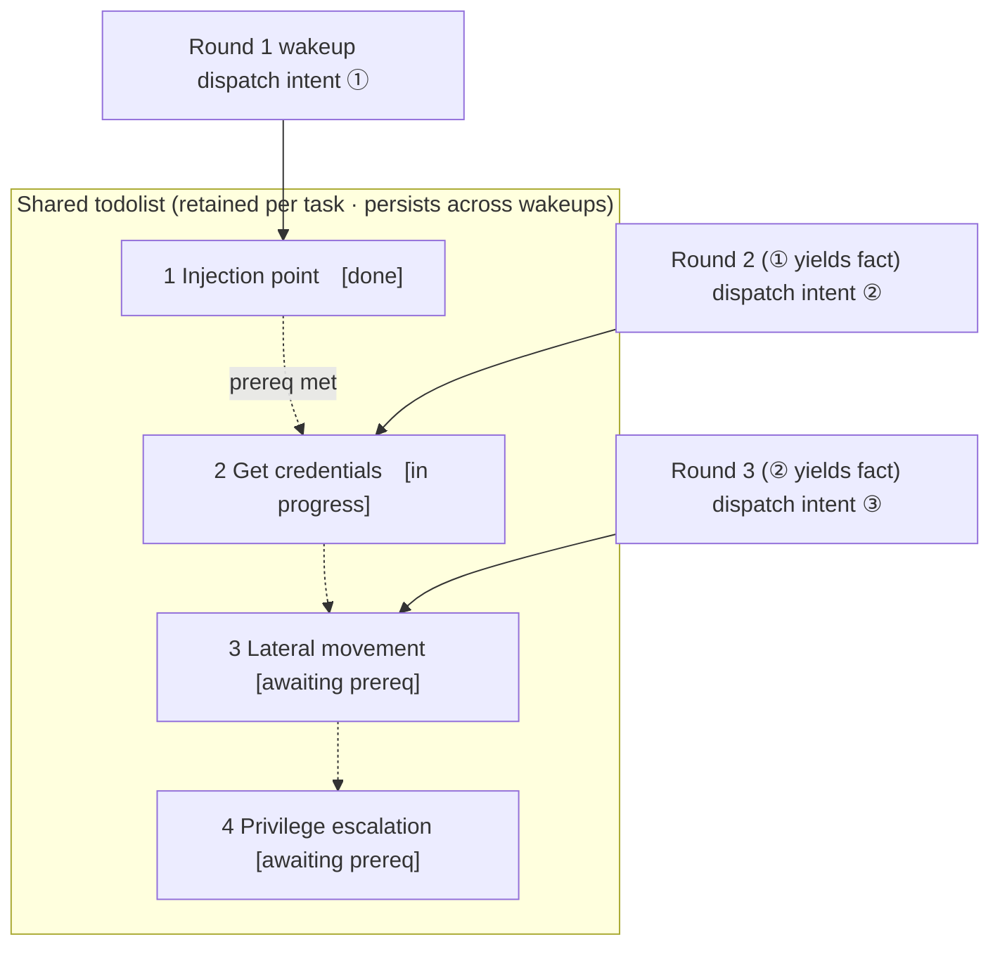

<div align="center">

# ARTEX

AI Autonomous Penetration Testing System (Go backend + Next.js frontend)


🌐 **Live Demo**: [https://artex-demo.vercel.app/](https://artex-demo.vercel.app/)

</div>

---

## Screenshots

> See the [Live Demo](https://artex-demo.vercel.app/) for the full interaction.

| Dashboard (Overview / Token usage / Activity stream) | Task list |
| :---: | :---: |
|  |  |

| Task · Execution process (sessions / tool calls) | Exploration chain |
| :---: | :---: |
|  |  |

| Findings | Assets |
| :---: | :---: |
|  |  |

| Asset coverage map (force-directed layout · tested assets highlighted · collapsible/expandable nodes) |
| :---: |
|  |

| Traffic recording | Human-in-the-loop chat |
| :---: | :---: |
|  |  |

| Agent management | LLM configuration |
| :---: | :---: |
|  |  |

| Interception approval | Backend logs |
| :---: | :---: |
|  |  |


---

## Approval record details

The global "Approval records" page, the in-task "Interception approval" view, and the approval cards in chat all support expanding to view details. The presentation follows the
[AegisHook approval-detail component](https://github.com/RuoJi6/AegisHook/blob/main/web/src/components/CallDetail.vue), reusing ARTEX's own components and theme:


## Asset sync (ScopeSentry)

Supports syncing asset data directly from [ScopeSentry](https://github.com/Autumn-27/ScopeSentry), avoiding duplicate collection:

- On the "**Asset sync**" page, enter the ScopeSentry address and API Key to connect the data source;
- Select the targets and asset types to sync by **project** or **task** dimension (domains / subdomains / IPs / ports / sites / endpoints…);
- Import with one click and merge by company asset scope, feeding directly into ARTEX's asset graph for agents to explore.

---

## Installation

> Requires **PostgreSQL**; exploration requires an **LLM** (`ANTHROPIC_API_KEY` or `OPENAI_API_KEY`, which can also be configured in the UI).

### Option 1: One-click install script (recommended)

```bash
git clone https://github.com/Autumn-27/ARTEX.git
cd ARTEX
./install.sh
```

The script will detect / auto-install Docker → let you choose **① All-in-Docker** or **② Build and run locally**:

- **① All-in-Docker**: enter a Postgres password (press Enter for a random one) → automatically write `.env` → `docker compose up -d`.
- **② Run locally**: choose a database (connect to an existing one / spin one up with Docker) → generate `config.json` → `go` compiles an embedded single binary → start.

After installation, open **http://localhost:8787** (on first visit, go to `/setup` to set the admin password).

### Option 2: Docker Compose (manual)

```bash
git clone https://github.com/Autumn-27/ARTEX.git
cd ARTEX
cp .env.example .env          # fill in POSTGRES_PASSWORD, optionally ANTHROPIC_API_KEY
docker compose up -d          # pull the autumn27/artex image + postgres
# → http://localhost:8787
```

The image already includes common tools (ripgrep/curl/vim/npm/nmap…); `./skills` and `./data` are persisted as bind mounts.

Remote MCP can be configured in system settings as either `http` (Streamable HTTP) or `sse` (legacy SSE).
A legacy SSE service typically uses `GET /sse` to establish the event stream, then receives JSON-RPC requests via the
`/message?sessionId=...` returned by the service; when configuring, set the URL to `/sse` and set the request header as
`Authorization=Bearer <token>`.

### Option 3: Download a precompiled binary (Releases)

Go to [Releases](https://github.com/Autumn-27/ARTEX/releases) and download the zip for your platform. Extracting it gives you `artex` + `start.sh` (`start.bat` on Windows) + `skills/` + `config.example.json`:

```bash
cp config.example.json config.json   # fill in the database connection
./start.sh                           # → http://localhost:8787
```

> Please start with `start.sh` / `start.bat` rather than running `./artex` directly. The script supervises the process: after the program exits, it uses the exit code to decide whether to restart it, and **the [one-click update](#option-1-in-page-one-click-update-recommended) on the page relies on it to complete the swap**. If you run `./artex` directly, it will not be restarted after an update.
> To keep it running in the background: `nohup ./start.sh >artex.log 2>&1 &`.

### Option 4: Build a single binary from source

```bash
# 1) Static export of the frontend
cd web && npm ci && npm run build:static && cd ..
# 2) Copy into the embed directory
cp -r web/out server/webui/dist
# 3) Build (only -tags embedui embeds the frontend)
CGO_ENABLED=0 go build -tags embedui -o artex ./cmd/artex
./start.sh
```

### Option 5: Build cross-platform release archives

`build.sh` first builds and embeds the frontend, then uses the Go linker to strip debug info and compresses the release files into zips. Release mode by default produces zips for Linux amd64/arm64, macOS amd64/arm64, and Windows amd64:

```bash
./build.sh --release
# Output: dist/artex-0.3.3-*.zip
```

UPX-compressed self-extracting binaries may be incompatible with some Linux kernels, virtualization environments, or security policies, so they are disabled by default. Use `ARTEX_TARGETS` to customize the targets; when you have confirmed the target runtime is compatible, you can explicitly pass `--upx` to shrink the binary further:

```bash
ARTEX_TARGETS=linux/amd64,windows/amd64 ./build.sh --release
./build.sh --target linux/amd64 --upx
```

---

## Updating and upgrading

> Upgrades only replace the program, not the data: the Postgres data volume `pgdata`, `./data` (jwt.key / SQLite, etc.), and `./skills` are all preserved. **Database migrations do not need to be run manually** — `artex` idempotently re-runs `schema.sql` on every startup (including `ADD COLUMN` / `CREATE INDEX IF NOT EXISTS`), i.e. "restart equals migrate". It is still recommended to back up `./data` and the database before upgrading.

### Option 1: In-page one-click update (recommended)

On the **System configuration** page (sidebar "System configuration" → `/system/settings`), the **Version and updates** card lets you check and install new versions directly, without logging into the server.

After clicking "Update": download the release package for the current platform → compare against the Release's `SHA256SUMS` → smoke-test the new binary with `-h` → stage it as `artex.new` → the program exits, and `start.sh` / `start.bat` relaunches and completes the swap. The page automatically waits for the new version to come online and then refreshes.

- **A failure never leaves a broken program behind**: if verification or the smoke test fails, the staged file is discarded and the current version keeps running; if the swapped-in new version fails to start 3 times in a row, it automatically rolls back to `artex.old` (the one that failed is kept as `artex.failed` for diagnosis).
- **Rollback anytime**: the previous version is kept as `artex.old`, and the card has a "Roll back to previous version" button. Note that the database schema does not roll back.
- **Updating interrupts running tasks** — updating means restarting, so do it when idle.
- **Development builds do not update**: when the version number is `dev` or a `git describe` string with a suffix, updating is disabled, to avoid an official release overwriting your locally debugged binary.
- **Under Docker, only the program is replaced, not the image**: the playwright / nmap toolchains in the image will not be upgraded along with it, and after `docker compose up -d` rebuilds the container it reverts to the versions bundled in the image. To upgrade the image too, still use `docker compose pull artex && docker compose up -d artex`.
- If accessing GitHub requires a proxy, configure the **global proxy** on the same page and the update path will use it. Updates are downloaded only from GitHub domains and are forced over HTTPS.

### Option 2: One-click update script

```bash
cd ARTEX
./update.sh
```

The script optionally runs `git pull` first to fetch the latest code, then lets you choose **① Docker update** or **② Local build update** (corresponding to `install.sh`):

- **① Docker**: you can specify the target image tag (press Enter to reuse `ARTEX_TAG` from `.env`, default `latest`) → `docker compose pull` → `docker compose up -d` (swapping in the new image and restarting auto-migrates).
- **② Local**: rebuild the static frontend output → recompile `./artex` (restart the process afterward for it to take effect).

### Option 3: Docker Compose (manual)

```bash
cd ARTEX
git pull                       # update compose / scripts (optional)
# To pin a version: set ARTEX_TAG=v0.2.0 in .env; otherwise latest is used
docker compose pull artex
docker compose up -d artex     # swap in the new image and restart → auto-migrate schema
docker image prune -f          # clean up old images (optional)
```

### Option 4: Precompiled binary (Releases)

Go to [Releases](https://github.com/Autumn-27/ARTEX/releases), download the new version's zip, stop the old process, overwrite `artex` and `skills/` (keeping your `config.json` and `data/`), and restart:

```bash
cp -r <extracted-dir>/skills ./ && cp <extracted-dir>/artex ./
./start.sh
```

### Option 5: Build from source

```bash
git pull
cd web && npm ci && npm run build:static && cd ..
cp -r web/out server/webui/dist
CGO_ENABLED=0 go build -tags embedui -o artex ./cmd/artex
# restart ./start.sh
```

---

## Configuration

**Database** (`config.json`, or override with the environment variable `ARTEX_PG_DSN`):

```json
{
  "database": {
    "host": "127.0.0.1", "port": 5432,
    "user": "artex", "password": "yourpass",
    "dbname": "artex", "sslmode": "disable"
  }
}
```

**LLM**: `export ANTHROPIC_API_KEY=sk-...` (or `OPENAI_API_KEY`); can also be set on the UI's "LLM configuration" page.
Optional: `ARTEX_LLM_PROVIDER` / `ARTEX_LLM_MODEL` / `ARTEX_LLM_BASE_URL` / `ARTEX_LLM_PROXY`.

**Concurrency**: the number of work agents per task is configured in "System settings" (default 3).

**Common parameters**: `./start.sh -addr :8787 -proxy :8788` (`-addr` is the frontend + API, `-proxy` is the traffic recording proxy). The start script passes the parameters through to `artex` as-is.

### Reverse-proxy deployment (HTTPS / only port 443 exposed)

The frontend and the API/SSE are served by the same backend port (default `:8787`), and the real-time activity stream uses a **same-origin** address by default, so **there is no need to configure `NEXT_PUBLIC_SSE_BASE`**: expose only 443 to the public and keep 8787 on the internal network.

SSE is a long-lived connection with continuous pushing, so the reverse proxy **must disable buffering**, otherwise the browser can connect but receives no events (manifesting as the activity stream spinning forever). Nginx example:

```nginx
server {
    listen 443 ssl;
    server_name your.domain.com;
    # ssl_certificate / ssl_certificate_key ...

    location / {
        proxy_pass http://127.0.0.1:8787;
        proxy_set_header Host $host;
        proxy_set_header X-Forwarded-Proto $scheme;

        # SSE essentials: disable buffering, long timeout, HTTP/1.1
        proxy_buffering off;
        proxy_cache off;
        proxy_read_timeout 3600s;
        proxy_http_version 1.1;
        proxy_set_header Connection "";
    }
}
```

> Only when SSE needs to use a different origin than the page (e.g. a separate subdomain) should you set `NEXT_PUBLIC_SSE_BASE` **at build time** (this variable is baked into the static bundle during `next build`; setting it at container runtime has no effect).

---


## Development

### Manual vulnerability retest

The "Retest" tab on the task detail page lets you page through this task's vulnerabilities, view past conclusions and evidence, and manually initiate a retest. After starting, it keeps the current tab, shows a spinner and "Retesting"; once a fix is confirmed, the vulnerability status is updated accordingly.

Click "Retest" in the action area of each row in the vulnerability list, or click "Initiate retest" in the "Vulnerability retest" section of the vulnerability detail, and fill in an optional fix version, test conditions, or restrictions. The system creates an independent retest Agent session and keeps the current page after starting. The flat list, the group-by-task view, and the asset view all support this entry point; while a retest is running it shows a spinner and "Retesting"; click to enter the corresponding session when you want to view it, and it returns to "Retest" when finished. A retest does not require restarting the original scan task. Conclusions fall into "Still reproducible", "Fixed", and "Cannot confirm"; each conclusion, its evidence, and the session link are saved in the vulnerability detail.

On first startup, the new backend pre-provisions an editable "Vulnerability retest" (`retester`) Agent, whose prompt, LLM, run budget, and tools can be configured in Agent management. It uses its bound LLM by default, or the globally active configuration if none is bound. When a retest session completes successfully with the conclusion "Fixed", the system automatically changes the vulnerability's disposition status to "Fixed"; executing, failed, stopped, or other conclusions keep the original status. The original evidence and report are always preserved. You can also manually choose "Fixed" from the status dropdown. When the same vulnerability is being retested, the existing session is reused; after a stop, failure, or service restart it can be re-initiated.

In this version the history is viewed via the vulnerability detail and the session; it is not yet included in the vulnerability report export or the task archive package, and is not yet automatically linked to traffic packages. Demo mode only generates clearly labeled simulated records and does not request real targets.

### Local run and testing

```bash
./dev.sh    # backend (:8787) + traffic proxy (:8788) + frontend next dev (:5173) → http://localhost:5173
```

- Backend: `go run ./cmd/artex` (without `-tags embedui`, the frontend is not embedded)
- Frontend: `cd web && npm run dev` (`/api` reverse-proxied to the backend, with hot reload)
- Tests: `go test ./...`
- Mock preview (no backend): `cd web && NEXT_PUBLIC_MOCK=1 npm run dev`

---

## System architecture

ARTEX is an **LLM multi-agent-driven autonomous penetration system**: a Go monolithic backend (with an embedded Next.js frontend) + PostgreSQL, with agent capabilities provided by the [`norma`](https://github.com/Autumn-27/norma) SDK (`agentcore` / `tool` / `permission` / `harness` / `memory` / `transcript`). At its core is a **dual-graph architecture**, plus two autonomy mechanisms built around it: **process-level information exchange between workers** and the **planner's multi-round shared todolist that stabilizes attack chains**.

### Overall layering



| Layer | Responsibility |
| --- | --- |
| **Frontend** | Next.js static export, embedded into the single binary via `go:embed`; visualizes tasks/assets/exploration chains/coverage map, and human-in-the-loop chat |
| **server** | `net/http` routing + JWT auth + SSE; the `Manager` owns the lifecycle of tasks, engines, and DB stores |
| **engine** | one `plannerLoop` + N worker goroutines per task; intent claiming, timeout/pause/drain |
| **agent** | goals / planner / worker / mainagent, with the `ToolSet` exposing the dual graph as LLM tools |
| **db** | Postgres persistence of the dual graph (pgx); the schema is idempotently created on every startup via `go:embed` |
| **Supporting** | recording MITM proxy, approval gate, async enrichment, MCP/skills/memory/report |

### Dual-graph architecture: exploration graph + asset graph

The system splits "**what the target is**" and "**how thoroughly it has been tested**" into two mutually independent graphs, connected via anchors:

- **Asset graph (globally shared)**: a single source-of-truth asset repository shared across tasks. Nodes are `root_domain / subdomain / ip / service / app / endpoint`, belonging to companies; the parent-child relationships domain→subdomain→service→endpoint and the deduplication keys are all computed by the program — agents only submit raw information.
- **Exploration graph (independent per task)**: the "thinking and progress" process of a single task. Nodes are `goal / intent / fact / finding / hint`, connected by edges such as `spawns / derived_from / yields / proves` into a **lineage chain** that answers "which direction was derived from which facts, and what did it produce".
- **The two graphs are connected via anchors**: `exploration_anchors(node_id, asset_id)` anchors intents/facts/findings to concrete assets — so you can both look at an "exploration direction" to see which assets it targets, and look at "a given asset" to see which intents tested it in this task and which facts they produced. This also powers **asset test coverage** and the **asset coverage map** (in-scope assets + tested ones highlighted).



> Division of labor: the **planner** reads the exploration-graph situation, judges goals, and dispatches **intents** into the frontier only when there is an uncovered new direction; the **worker** claims **one intent**, executes it with real tools, writes new assets/facts/findings back into both graphs, and then stops. The asset graph is the shared source of truth; the exploration graph records each task's progress.

### Engine and intent lifecycle (one closed exploration loop)

The engine is an **event-driven** loop: any change to the graph wakes the planner, which dispatches intents. A worker claims an intent, executes it, and writes the results back; each write-back triggers the next round — until the goal is proven (`prove_goal`).



### Process-level information exchange between workers

In an in-depth exploration, many valuable observations (an error message, a snippet of response, a hidden parameter) appear in the **execution process** of one worker, yet are not necessarily written up as a formal fact. To avoid duplicated effort and let workers in the chain stand on each other's shoulders, workers can **search across other works' processes**:

- `search_all_worker_traces(q)`: search by keyword across **the execution processes of other works in this task** (automatically excluding steps of one's own intent), with hits carrying an `intent_id`;
- `list_worker_traces` / `get_worker_trace(intent_id, step_ids=[…])`: first see which works have run, then fetch the full content of a specific work's specific steps for detailed exchange.

This way, even if there is no corresponding fact on the exploration graph yet, later workers can reuse others' process observations — **information flows between workers at the granularity of "execution process"**, while the boundary stays fixed (each worker still only works on the single intent it claimed).



### Planner's multi-round shared todolist → stable attack chains

Real attack chains are often **multi-step sequences with dependencies** (e.g. find an injection point → obtain credentials → move laterally → escalate privileges); dispatching all of these in parallel at once only causes chaos. The planner therefore holds a **planning todolist that is retained per task and shared across wakeups**:

- The planner is event-driven — any change to the graph wakes it, but **each wakeup is a fresh session**; the shared todolist lets it **record a serial exploitation chain once**, then **dispatch intents step by step across subsequent rounds along the dependencies**, rather than laying out the whole chain up front in one round;
- Each round it dispatches an intent only for the next step whose prerequisites are complete and whose dependent facts already exist, then updates the list as progress is made (marking steps complete once their facts are satisfied).



So the attack chain still **advances stably, without repetition or misordering** even in an "event-driven + stateless session" environment — this is the key to ARTEX autonomously completing multi-step exploitation chains.

---

## Community

Scan the code to follow the WeChat official account **SecSentry**, and DM the account's backend to join the discussion group.

<div align="center">


</div>

---
## References

https://github.com/oritera/Cairn


## License and disclaimer

### Open-source license

This project is licensed under the **GNU Affero General Public License v3.0 (AGPL-3.0)**; the full terms are in the [LICENSE](LICENSE) file at the repository root.

This means anyone is free to use, modify, and distribute this project, but **derivative works must also be open-sourced under AGPL-3.0**; in particular, **if you modify this project and provide it to users over a network (e.g. deploying it as an online service), you must also make the corresponding complete source code available to those users**.

> ⚠️ **Important**: The open-source license itself does not restrict how the software is used. The "Usage restrictions" and "Disclaimer" below are additional conditions and a solemn statement from the author to users — please observe them.

**ARTEX is intended solely for personal study, code research, and local technical validation. It must not be used to launch actual testing against any online system or website.**

### Permitted scope of use

- May be used only for **reading, studying, and researching this project's source code**, and for validating technical principles in a **locally isolated environment**;
- Suitable for personal learning, academic research, code review, and other non-offensive purposes.

### Prohibited

- **It is strictly forbidden to use this tool to scan, probe, exploit, or attack any website, online service, or networked system** (whether or not authorized, and whether or not the asset is your own);
- It is strictly forbidden to use this tool for any actual penetration testing, red/blue team exercises, or production environments;
- It is strictly forbidden to use this tool for illegal intrusion, data theft, extortion, denial of service, or any destructive or criminal activity;
- It is strictly forbidden to use this tool for any activity that violates the laws and regulations of your country/region.

### Compliance responsibility

Users must comply with all laws and regulations in their country/region regarding cybersecurity, data protection, and computer crime (in mainland China, including but not limited to the Cybersecurity Law, the Data Security Law, the Personal Information Protection Law, and related judicial interpretations). **All legal liability and consequences arising from the use of this tool are borne solely by the user.**

### Disclaimer

This project is provided "AS IS", without any express or implied warranty. The author and contributors are not liable for any direct or indirect loss, data loss, system damage, or legal dispute caused by the use of this tool (whether or not used appropriately). **By downloading, installing, or using this project, you acknowledge that you have read, understood, and agreed to all of the above terms.**
