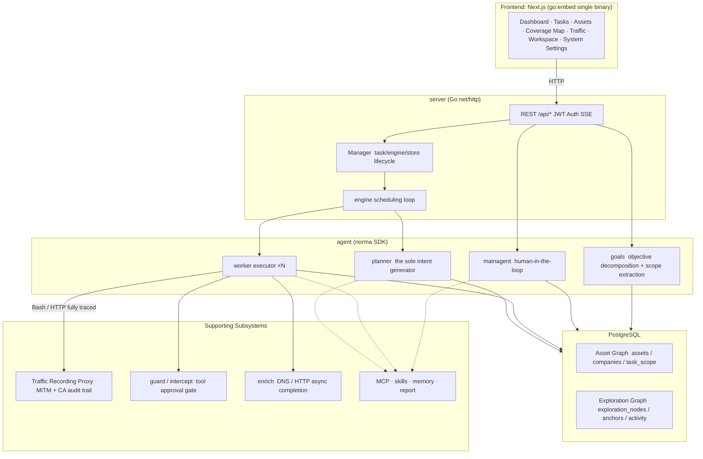
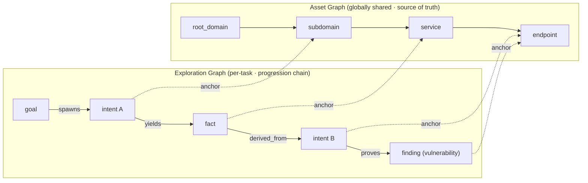
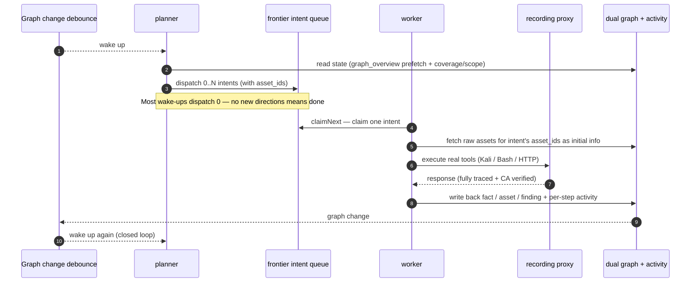
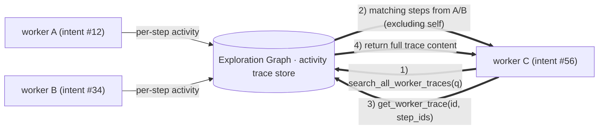
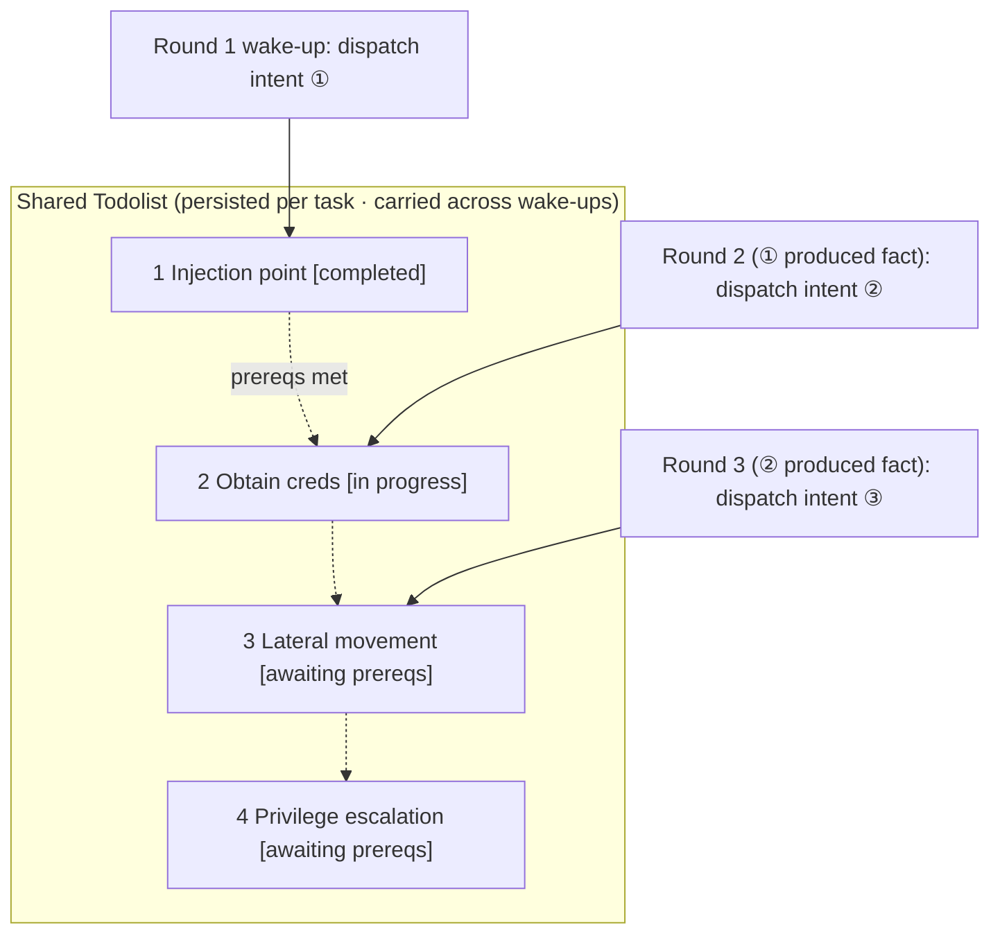

<div align="center">

# ARTEX

AI-Driven Autonomous Penetration Testing System (Go Backend + Next.js Frontend)


🌐 **Live Demo**: [https://artex-demo.vercel.app/](https://artex-demo.vercel.app/)

</div>

---

## Screenshots

> See full interactive walkthrough at the [Live Demo](https://artex-demo.vercel.app/).

| Dashboard (Overview / Token Usage / Activity Stream) | Task List |
| :---: | :---: |
|  |  |

| Task · Execution Progress (Sessions / Tool Calls) | Exploration Graph |
| :---: | :---: |
|  |  |

| Findings | Assets |
| :---: | :---: |
|  |  |

| Asset Coverage Map (Force-Directed Layout · Tested Assets Highlighted · Collapsible Nodes) |
| :---: |
|  |

| Traffic Recording | Human-in-the-Loop Chat |
| :---: | :---: |
|  |  |

| Agent Management | LLM Configuration |
| :---: | :---: |
|  |  |

| Intercept & Approval | Backend Logs |
| :---: | :---: |
|  |  |


---

## Approval Record Details

The global "Approval Records", in-task "Intercept & Approval", and approval cards within conversations all support expanding to view details. The detail structure is based on
[AegisHook's approval detail component](https://github.com/RuoJi6/AegisHook/blob/main/web/src/components/CallDetail.vue), adapted to ARTEX's component library and theme.


## Asset Sync (ScopeSentry)

Supports direct asset data synchronization from [ScopeSentry](https://github.com/Autumn-27/ScopeSentry), eliminating redundant reconnaissance:

- On the **Asset Sync** page, enter ScopeSentry's address and API Key to connect the data source;
- Select targets and asset types (domains / subdomains / IPs / ports / sites / endpoints...) by **project** or **task** scope;
- One-click import, consolidated by company asset scope, feeding directly into ARTEX's asset graph for agent exploration.

---

## Installation

> Requires **PostgreSQL**; exploration requires an **LLM** configuration (`ANTHROPIC_API_KEY` or `OPENAI_API_KEY`, also configurable in the UI).

### Option 1: One-Click Install Script (Recommended)

```bash
git clone https://github.com/Autumn-27/ARTEX.git
cd ARTEX
./install.sh
```

The script will: detect / auto-install Docker → let you choose **① Full Docker** or **② Local Build & Run**:

- **① Full Docker**: Enter a Postgres password (press Enter for random) → auto-generates `.env` → `docker compose up -d`.
- **② Local Run**: Choose database (connect to existing / spin up via Docker) → generates `config.json` → `go` compiles into a single embedded binary → starts.

Once installed, open **http://localhost:8787** (first visit redirects to `/setup` to set the admin password).

### Option 2: Docker Compose (Manual)

```bash
git clone https://github.com/Autumn-27/ARTEX.git
cd ARTEX
cp .env.example .env          # Set POSTGRES_PASSWORD; optionally ANTHROPIC_API_KEY
docker compose up -d          # Pulls autumn27/artex image + postgres
# → http://localhost:8787
```

The image includes common tools (ripgrep/curl/vim/npm/nmap...); `./skills` and `./data` are persisted via bind mounts.

Remote MCP can be configured in system settings to use `http` (Streamable HTTP) or `sse` (legacy SSE).
Legacy SSE services typically use `GET /sse` to establish the event stream, then receive JSON-RPC requests via the
`/message?sessionId=...` endpoint returned by the server; set the URL to `/sse` and fill in the request headers as
`Authorization=Bearer <token>`.

### Option 3: Download Precompiled Binaries (Releases)

Go to [Releases](https://github.com/Autumn-27/ARTEX/releases) to download the zip for your platform. After extraction you'll find `artex` + `start.sh` (Windows: `start.bat`) + `skills/` + `config.example.json`:

```bash
cp config.example.json config.json   # Fill in your database connection
./start.sh                           # → http://localhost:8787
```

> Use `start.sh` / `start.bat` to launch, not `./artex` directly. It's a supervisor script: after the process exits, it decides whether to restart based on the exit code — **the [one-click update](#option-1-in-app-one-click-update-recommended) relies on it to swap binaries**. Running `./artex` directly means the process won't be restarted after an update.
> Run as daemon: `nohup ./start.sh >artex.log 2>&1 &`.

### Option 4: Build Single Binary from Source

```bash
# 1) Frontend static export
cd web && npm ci && npm run build:static && cd ..
# 2) Copy into the embed directory
cp -r web/out server/webui/dist
# 3) Build (the -tags embedui flag embeds the frontend)
CGO_ENABLED=0 go build -tags embedui -o artex ./cmd/artex
./start.sh
```

### Option 5: Build Cross-Platform Release Archives

`build.sh` first builds and embeds the frontend, then uses Go linker flags to strip debug info, and compresses the release files into zips. Release mode generates zip packages for Linux amd64/arm64, macOS amd64/arm64, and Windows amd64 by default:

```bash
./build.sh --release
# Output: dist/artex-0.3.3-*.zip
```

UPX self-extracting binaries may be incompatible with certain Linux kernels, virtualization environments, or security policies, so UPX is disabled by default. Use `ARTEX_TARGETS` to customize targets; when you've confirmed the target environment is compatible, pass `--upx` explicitly to further reduce binary size:

```bash
ARTEX_TARGETS=linux/amd64,windows/amd64 ./build.sh --release
./build.sh --target linux/amd64 --upx
```

---

## Updating / Upgrading

> Upgrades only replace the program, not the data: the Postgres data volume `pgdata`, `./data` (jwt.key / SQLite, etc.), and `./skills` are all preserved. **Database migrations require no manual steps** — `artex` idempotently re-runs `schema.sql` on every startup (including `ADD COLUMN` / `CREATE INDEX IF NOT EXISTS`), following a "restart = migrate" approach. It's still recommended to back up `./data` and the database before upgrading.

### Option 1: In-App One-Click Update (Recommended)

On the **System Settings** page (sidebar "System Settings" → `/system/settings`), the **Version & Updates** card lets you check for and install new versions directly, without logging into the server.

After clicking "Update": downloads the release package for the current platform → verifies against the Release's `SHA256SUMS` → smoke-tests the new binary with `-h` → stages it as `artex.new` → the process exits, and `start.sh` / `start.bat` restarts and completes the swap. The page automatically refreshes once the new version comes online.

- **A failed update won't leave a broken binary**: if verification or smoke test fails, the staged file is discarded and the current version continues running; if the new version fails to start 3 consecutive times after the swap, it automatically rolls back to `artex.old` (the failed one is kept as `artex.failed` for debugging).
- **Rollback at any time**: the previous version is kept as `artex.old`, and the card includes a "Roll back to previous version" button. Note that database schema changes are not rolled back.
- **Updates interrupt running tasks** — an update means a restart, so perform updates during idle periods.
- **Dev builds are excluded from updates**: when the version is `dev` or `git describe` includes a suffix, updates are disabled to prevent release builds from overwriting locally-built debug binaries.
- **Under Docker, only the binary is replaced, not the image**: tools bundled in the image (playwright / nmap, etc.) won't be upgraded, and `docker compose up -d` will revert to the image's bundled version when the container is recreated. To upgrade the image as well, use `docker compose pull artex && docker compose up -d artex`.
- If accessing GitHub requires a proxy, configure the **Global Proxy** on the same page — the update pipeline will use it. Updates only download from GitHub domains and enforce HTTPS.

### Option 2: One-Click Update Script

```bash
cd ARTEX
./update.sh
```

The script optionally runs `git pull` to fetch the latest code, then lets you choose **① Docker Update** or **② Local Build Update** (mirroring `install.sh`):

- **① Docker**: optionally specify a target image tag (press Enter to use the `ARTEX_TAG` from `.env`, defaults to `latest`) → `docker compose pull` → `docker compose up -d` (swaps to new image and auto-migrates on restart).
- **② Local**: rebuilds frontend static assets → recompiles `./artex` (restart the process after completion to take effect).

### Option 3: Docker Compose (Manual)

```bash
cd ARTEX
git pull                       # Update compose / scripts (optional)
# Pin a version: set ARTEX_TAG=v0.2.0 in .env; omit to use latest
docker compose pull artex
docker compose up -d artex     # Swaps to new image, auto-migrates schema on restart
docker image prune -f          # Clean up old images (optional)
```

### Option 4: Precompiled Binaries (Releases)

Go to [Releases](https://github.com/Autumn-27/ARTEX/releases) to download the new version zip. Stop the old process, then overwrite `artex` and `skills/` (keep your `config.json` and `data/`), and restart:

```bash
cp -r <extracted_dir>/skills ./ && cp <extracted_dir>/artex ./
./start.sh
```

### Option 5: Build from Source

```bash
git pull
cd web && npm ci && npm run build:static && cd ..
cp -r web/out server/webui/dist
CGO_ENABLED=0 go build -tags embedui -o artex ./cmd/artex
# Restart ./start.sh
```

---

## Configuration

**Database** (`config.json`, or override with the environment variable `ARTEX_PG_DSN`):

```json
{
  "database": {
    "host": "127.0.0.1", "port": 5432,
    "user": "artex", "password": "yourpass",
    "dbname": "artex", "sslmode": "disable"
  }
}
```

**LLM**: `export ANTHROPIC_API_KEY=sk-...` (or `OPENAI_API_KEY`), also configurable on the "LLM Configuration" page in the UI.
Optional: `ARTEX_LLM_PROVIDER` / `ARTEX_LLM_MODEL` / `ARTEX_LLM_BASE_URL` / `ARTEX_LLM_PROXY`.

**Concurrency**: The number of work agents per task is configured in "System Settings" (default: 3).

**Common parameters**: `./start.sh -addr :8787 -proxy :8788` (`-addr` for frontend + API, `-proxy` for the traffic recording proxy). The startup script passes all arguments through to `artex`.

### Reverse Proxy Deployment (HTTPS / Expose Only Port 443)

The frontend and API/SSE are both served from the same backend port (default `:8787`). The real-time activity stream defaults to the **same-origin** address, so **there's no need to configure `NEXT_PUBLIC_SSE_BASE`** — just expose port 443 publicly and keep 8787 on the internal network.

SSE uses long-lived connections with continuous push, so the reverse proxy **must disable buffering**, otherwise the browser can connect but won't receive events (the activity stream will show a perpetual loading spinner). Nginx example:

```nginx
server {
    listen 443 ssl;
    server_name your.domain.com;
    # ssl_certificate / ssl_certificate_key ...

    location / {
        proxy_pass http://127.0.0.1:8787;
        proxy_set_header Host $host;
        proxy_set_header X-Forwarded-Proto $scheme;

        # SSE essentials: disable buffering, long timeout, HTTP/1.1
        proxy_buffering off;
        proxy_cache off;
        proxy_read_timeout 3600s;
        proxy_http_version 1.1;
        proxy_set_header Connection "";
    }
}
```

> Only set `NEXT_PUBLIC_SSE_BASE` **at build time** if SSE needs to be served from a different origin than the page (e.g., a separate subdomain). This variable is baked into the static bundle during `next build` — setting it at container runtime has no effect.

---


## Development

### Manual Vulnerability Retesting

The "Retest" tab in task details allows paginated selection of vulnerabilities from the current task, viewing past conclusions and evidence, and manually initiating a retest. Once started, the current tab is preserved, showing a spinner and "Retesting" status; upon confirming a fix, the vulnerability status is updated accordingly.

Click "Retest" in the action area of each vulnerability row, or click "Initiate Retest" in the "Vulnerability Retest" section of the vulnerability detail view, and optionally fill in the fix version, test conditions, or constraints. The system creates an independent retest Agent session and preserves the current page after launch. The flat list, group-by-task, and asset views all support this entry point; during retesting, a spinner and "Retesting" label are shown — click to enter the corresponding session when needed. After completion, the button reverts to "Retest". Retesting does not require restarting the original scan task. Conclusions are categorized as "Still Reproducible", "Fixed", or "Inconclusive", and each retest's conclusion, evidence, and session link are saved in the vulnerability details.

On the first startup with the new backend, an editable "Vulnerability Retest" (`retester`) Agent is pre-provisioned and can be configured in Agent Management with custom prompts, LLM, runtime budget, and tools. It defaults to its bound LLM; if none is bound, it uses the globally active configuration. When a retest session completes successfully with a "Fixed" conclusion, the system automatically changes the vulnerability's disposition status to "Fixed"; for in-progress, failed, stopped, or other conclusions, the original status is preserved. Original evidence and reports are always retained. You can also manually select "Fixed" from the status dropdown. If a retest is already in progress for the same vulnerability, the existing session is reused; after stopping, failure, or server restart, a new retest can be initiated.

In the current version, historical records are viewed through vulnerability details and sessions; they are not yet included in vulnerability report exports or task archive packages, and traffic captures are not automatically associated. Demo mode generates only clearly labeled simulated records and does not make requests to real targets.

### Local Development & Testing

```bash
./dev.sh    # Backend(:8787) + Traffic proxy(:8788) + Frontend next dev(:5173) → http://localhost:5173
```

- Backend: `go run ./cmd/artex` (without `-tags embedui`, the frontend is not embedded)
- Frontend: `cd web && npm run dev` (`/api` proxied to backend, with hot reload)
- Tests: `go test ./...`
- Mock preview (no backend): `cd web && NEXT_PUBLIC_MOCK=1 npm run dev`

---

## System Architecture

ARTEX is an **LLM multi-agent driven autonomous penetration testing system**: a Go monolith backend (with embedded Next.js frontend) + PostgreSQL. Agent capabilities are provided by the [`norma`](https://github.com/Autumn-27/norma) SDK (`agentcore` / `tool` / `permission` / `harness` / `memory` / `transcript`). The core is a **dual-graph architecture**, supported by two autonomy mechanisms: **process-level information exchange between workers** and **planner's multi-round shared todolist for stable attack chains**.

### Overall Layered Architecture



| Layer | Responsibility |
| --- | --- |
| **Frontend** | Next.js static export, embedded into a single binary via `go:embed`; visualizes tasks/assets/exploration graph/coverage map, human-in-the-loop chat |
| **server** | `net/http` routing + JWT auth + SSE; `Manager` manages task, engine, and DB store lifecycle |
| **engine** | One `plannerLoop` + N worker goroutines per task; intent claiming, timeout/pause/drain |
| **agent** | goals / planner / worker / mainagent; `ToolSet` exposes the dual graph as LLM tools |
| **db** | Postgres persistence for the dual graph (pgx); schema idempotently created on each startup via `go:embed` |
| **supporting** | Recording MITM proxy, approval gate, async enrichment, MCP/skills/memory/report |

### Dual-Graph Architecture: Exploration Graph + Asset Graph

The system separates "**what are the targets**" from "**how thoroughly have they been tested**" into two independent graphs connected via anchor points:

- **Asset Graph (globally shared)**: A single source-of-truth asset repository shared across tasks. Nodes are `root_domain / subdomain / ip / service / app / endpoint`, belonging to companies; the parent-child relationships (domain → subdomain → service → endpoint) and deduplication keys are all computed by the program — agents only submit raw information.
- **Exploration Graph (per-task)**: The "thinking and progression" process of a single task. Nodes are `goal / intent / fact / finding (vulnerability) / hint`, connected by edges like `spawns / derived_from / yields / proves` to form a **lineage chain** that answers "which direction was derived from which facts, and what did it produce."
- **The two graphs are connected via anchor points**: `exploration_anchors(node_id, asset_id)` anchors intents/facts/findings to specific assets — enabling both viewing which assets a given exploration direction targeted, and reverse-querying from a specific asset to see which intents tested it in this task and what facts were discovered. This also powers **asset test coverage** and the **asset coverage map** (in-scope assets + tested highlights).



> Division of labor: The **planner** reads the exploration graph state, assesses objectives, and only dispatches **intents** to the frontier when there are uncovered new directions; the **worker** claims **one intent**, executes it with real tools, writes new assets/facts/findings back to both graphs, then stops. The asset graph is the shared source of truth; the exploration graph is the per-task progression chain.

### Engine & Intent Lifecycle (The Closed Loop of a Single Exploration)

The engine is an **event-driven** closed loop: when the graph changes, the planner is awakened; the planner dispatches intents; workers claim and execute intents and write back results; the write-back triggers the next round — until the goal is proven (`prove_goal`).



### Process-Level Information Exchange Between Workers

During an in-depth exploration, many valuable observations (a specific error message, a response snippet, a hidden parameter) emerge during a worker's **execution process** but may not be written as a formal fact. To avoid redundant work and let workers along the chain build on each other's findings, workers have the ability to **search execution traces across other workers**:

- `search_all_worker_traces(q)`: keyword search across **other workers' execution traces in the current task** (automatically excludes steps from the worker's own intent), with hits tagged by `intent_id`;
- `list_worker_traces` / `get_worker_trace(intent_id, step_ids=[...])`: first see which workers have run, then retrieve the full content of specific steps from a particular worker for detailed information exchange.

This way, even if a corresponding fact hasn't been written to the exploration graph yet, subsequent workers can reuse observations from others' processes — **information flows between workers at the "execution trace" granularity**, while boundaries remain unchanged (each worker still only works on the intent it claimed).



### Planner's Multi-Round Shared Todolist → Stable Attack Chains

Real attack chains are often **multi-step sequences with dependencies** (e.g.: discover injection point → obtain credentials → lateral movement → privilege escalation). Dispatching all of these in parallel at once would only cause chaos. The planner therefore maintains a **shared planning todolist that persists per task and carries over across wake-ups**:

- The planner is event-driven — it's awakened whenever the graph changes, but **each wake-up is a fresh session**; the shared todolist lets it **record a serial exploitation chain once** and then **dispatch intents step-by-step based on dependencies** across subsequent rounds, rather than fully expanding the entire chain in a single round;
- Each round only dispatches the next step whose prerequisites have been completed (i.e., the required facts already exist), and updates the checklist as progress is made (marking steps as complete once their corresponding facts are satisfied).



Thus the attack chain **progresses stably, without repetition or misordering** even in an "event-driven + stateless session" environment — this is the key to ARTEX's ability to autonomously complete multi-step exploitation chains.

---

## Community

Follow the WeChat public account **SecSentry** and send a private message via the account to join the community group.

<div align="center">


</div>

---
## References

https://github.com/oritera/Cairn


## License & Disclaimer

### Open Source License

This project is licensed under the **GNU Affero General Public License v3.0 (AGPL-3.0)**. The full license text can be found in the [LICENSE](LICENSE) file at the repository root.

This means anyone is free to use, modify, and distribute this project, but **derivative works must also be open-sourced under AGPL-3.0**; in particular, **if you modify this project and provide it to users over a network (e.g., deployed as an online service), you must also make the corresponding complete source code available to those users**.

> ⚠️ **Important Notice**: The open source license itself does not restrict the use cases of the software. The following "Usage Restrictions" and "Disclaimer" are additional stipulations and solemn declarations from the author to users — please be sure to comply.

**ARTEX is intended solely for personal learning, source code research, and local technical validation. It must not be used to conduct actual testing against any online system or website.**

### Permitted Use

- May only be used for **reading, studying, and researching this project's source code**, as well as technical principle verification in **local isolated environments**;
- Suitable for personal learning, academic research, code review, and other non-offensive purposes.

### Prohibited Activities

- **It is strictly forbidden to use this tool to scan, probe, exploit, or attack any website, online service, or networked system** (regardless of whether authorization has been obtained or whether the assets are self-owned);
- It is strictly forbidden to use this tool for any actual penetration testing, red team/blue team exercises, or production environments;
- It is strictly forbidden to use this tool for unauthorized intrusion, data theft, ransomware, denial of service, or any destructive or criminal activity;
- It is strictly forbidden to use this tool to engage in any behavior that violates the laws and regulations of the user's country or region.

### Compliance Responsibility

Users must independently comply with all laws and regulations in their country/region regarding cybersecurity, data protection, and computer crimes (in mainland China, this includes but is not limited to the Cybersecurity Law, Data Security Law, Personal Information Protection Law, and related judicial interpretations). **All legal liability and consequences arising from the use of this tool are solely borne by the user.**

### Disclaimer

This project is provided "AS IS" without any express or implied warranties. The author and contributors shall not be held liable for any direct or indirect losses, data loss, system damage, or legal disputes caused by the use of this tool (regardless of whether the manner of use was appropriate). **By downloading, installing, or using this project, you acknowledge that you have read, understood, and agreed to all of the above terms.**
