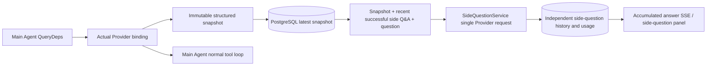

# ARTEX `/btw`

Ordinary chat, the task MainAgent, and the current task's own Worker support independent side questions. Type `/btw <question>` in the main input box to submit; an empty `/btw` or the "Side question" button opens the history. Desktop uses a resizable side panel; mobile uses a Drawer.

A side answer is generated from a snapshot of the Agent's context at submission time, and supports streaming display, follow-ups, stop, and clear. Closing the panel, refreshing the page, or dropping the SSE connection does not cancel the model request. Stop affects only the current side question; clear cancels the side question and deletes the side-question history, while preserving the main context snapshot.

## Implementation boundaries

It reuses Go, norma v0.3.7, Next.js, and the existing Markdown / ResizablePanel / Drawer / AlertDialog components; it does not modify the norma source or add a dependency for the side question. The Planner, Workers inherited from other tasks, and tool-type subtask upgrades are out of scope for this round.

- `capture.go` marks a main-loop request only in `Options.Deps.CallModel / CallModelSync`. The Provider decorator sits inside the concrete model, after the routing pool's outer selection, and therefore records the actually selected model; compaction and summary requests do not overwrite the snapshot.
- The snapshot is published at the request start, the complete model reply, and the run's terminal state. A half-finished reply still being generated is not published; tool calls stay paired via norma's `MessagesForAPI`, and a tool result enters the snapshot at the next main-model request or the run's terminal state. A streaming abort keeps the previous valid boundary.
- The snapshot preserves structured messages, the system prompt, tool definitions, and generation parameters via JSON deep copy. Model inference does not hold the snapshot lock or a database transaction.
- `SideQuestionService` calls the concrete Provider and, if necessary, first generates a side-question summary. The final-answer request is retried once with a smaller context only if the first attempt exceeds the context window before emitting any text or tool call. The service does not create an agent session, connect to the tool executor, main transcript, activity stream, or task graph, or use the task's model-switching chain. The answer retains tool definitions to remain compatible with the existing structured tool context; summary requests have no tools. Returned tool calls cannot be executed.
- One running request per parent session, at most four per single service process, with a single timeout of 120 seconds. The side question uses an independent cancellation context under the service lifecycle.
- A side-question request keeps a reference to the model configuration and a non-sensitive identity summary; credentials are obtained from the existing configuration at request time. If the configuration is deleted, or identity fields such as model, protocol, or address change, it requires running the main Agent first to update the snapshot. Tests do not change the product's default model.

## Persistence and recovery

`db/schema.sql` automatically creates `side_question_sessions` and `side_question_requests`. The former stores the parent resource, latest snapshot, run number, version, and clear version; the latter stores the question, accumulated answer, status, model, snapshot time, usage, event ordinal, and pagination ordinal.

The parent-session key uses the conversation ID, or task ID + exploration ID + intent ID. A Worker does not use a reusable execution-slot name.

Snapshots are merge-written per parent session, flushed every 250 ms, with the database comparing `(run_id, version)` to prevent an old version from overwriting. The selected snapshot is saved again before the side question is submitted. After a successful save, the large in-memory snapshot is released; on failure, the pending version is retained. Accumulated answer content is written at most every 250 ms as streaming events arrive, and the terminal state is saved immediately with bounded retries on database error.

On service startup, lingering `running` requests are marked `interrupted`; any partial answer and usage already persisted are retained, and the request is not replayed automatically. The latest successfully saved context is reused for the next question. If an older session has no snapshot, run the main Agent once to create one; side questions do not rebuild context from UI activity records.

A clear operation increments the clear version and deletes the requests; a conditional update blocks a late callback from writing back. Physical deletion of the parent resource relies on foreign-key cascade; a Worker logical deletion removes the side-question data in the same transaction and rejects subsequent late snapshots. Task archiving first blocks new requests, waits for the main flow to stop, cancels and waits for the side question to persist; the archive format is v3, while remaining compatible with v1/v2 that lack the side-question tables.

History is fully preserved, returning at most 20 entries per page via an ordinal cursor. A model request replays at most the original text of the 20 most recent successful Q&A pairs, while also limiting the replay volume by a token budget; older Q&A pairs maintain an independent rolling summary. When the main context exceeds the budget, only the old part of the side copy is summarized, preserving recent structured tool calls and results. Summarization, preparation progress, and usage are all subject to the side question's concurrency, cancellation, and 120-second timeout limits. See [Context budget and open-source references](CONTEXT_BUDGET.en.md) for details.

## HTTP contract

The following paths serve as `{parent}`, reusing the existing authentication and resource validation:

- `/api/conversations/{id}`
- `/api/tasks/{id}/chat`
- `/api/tasks/{id}/intents/{iid}`

| Request | Response and behavior |
| --- | --- |
| `GET {parent}/side-questions?before={ordinal}` | `items` ordered newest-to-oldest, independent `current` run status, `snapshot` metadata, `next_cursor`; a cursor of 0 means the latest page / no next page |
| `POST {parent}/side-questions` | JSON `{ "question": "…", "client_request_id": "UUID" }`; a new request returns 202 and the request object; the same ID and question returns the existing object with 200 |
| `DELETE {parent}/side-questions` | cancel and clear the current parent session's side Q&A |
| `GET /api/side-questions/{requestID}/events` | `snapshot` SSE events, with `id` an increasing ordinal and `data` the complete accumulated request object; on clear it sends `cleared` |
| `POST /api/side-questions/{requestID}/cancel` | explicit cancellation; the terminal state can be read from history or SSE |

The question limit is 4000 characters. A missing snapshot, a changed model configuration, an already-busy parent session, or an idempotency-ID conflict returns 409; the global concurrency limit returns 429. Each SSE connection first sends the accumulated state, so it does not rely on text fragments previously received by the client. The frontend merges by request ID + ordinal and discards old callbacks when switching parent sessions or clearing.

## Validation and references

See [VALIDATION.en.md](VALIDATION.en.md) for the automated checks, actual model usage, and known limitations.

For the standalone request, see [Grok CLI side-question.ts (pinned commit)](https://github.com/superagent-ai/grok-cli/blob/fb97af83f06dca873281d60168430f06c8de6324/src/utils/side-question.ts); for run isolation, see [OpenCode (pinned commit)](https://github.com/anomalyco/opencode/tree/b3f1a96c6dd7adeb28b36dd11add1998fc84d67b). ARTEX's context uses norma's structured messages, rather than the approach of stitching text together from frontend logs.
