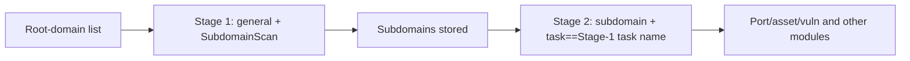

# ScopeSentry MCP usage guide

For users with an **already-deployed ScopeSentry instance**. Connect to the platform via Cursor (or another MCP client); no local source code is needed.

## 1. Preparation

### 1.1 Confirm the service is reachable

- Default web interface: `http://<host>`
- MCP endpoint: `http://<host>/mcp` (if there is a reverse proxy or frontend proxy in front, use the actual `/mcp` address)

### 1.2 Create an API Key

1. Log in to the ScopeSentry web interface in your browser
2. Go to the **API Key** management page and create a key (or create one via an admin-provided interface)
3. Save the returned `ssk_...` string (**shown only once**)

### 1.3 Configure Cursor MCP

Cursor → Settings → MCP → add a server:

```json
{
  "mcpServers": {
    "scopesentry": {
      "url": "http://<your-host>:8082/mcp",
      "headers": {
        "X-API-Key": "ssk_your-key"
      }
    }
  }
}
```

You can also use: `Authorization: Bearer ssk_your-key`

After configuring, restart the MCP or reload Cursor, and confirm that tools like `list_projects` and `list_assets` appear in the tool list.

---

## 2. Tool overview


| Tool                     | Purpose                |
| ---------------------- | ----------------- |
| `list_projects`        | project tree grouped by tag (incl. project ID) |
| `list_projects_data`   | paginated project list, searchable by name     |
| `get_project`          | project detail              |
| `create_project`       | create a project              |
| `list_tasks`           | scan task list            |
| `get_task`             | task detail              |
| `list_scan_templates`  | scan template list            |
| `get_scan_template`    | template detail              |
| `list_plugin_modules`  | scan-pipeline module names          |
| `list_plugins`         | available plugins (incl. hash, default parameters) |
| `create_scan_template` | create a scan template            |
| `create_scan_task`     | create a scan task            |
| `list_assets`          | query assets of various types (paginated list)       |
| `count_assets`         | count assets (`/api/assets/common/total`) |
| `get_asset_detail`     | asset or vulnerability detail           |
| `add_asset_tag`        | add a tag to an asset           |
| `list_nodes`           | scan node list            |


Each tool's parameters are defined by the MCP tool description (schema); the search and filter syntax for `list_assets` / `count_assets` is identical, and you can read the `list_assets` description before querying assets.

When you need to know "how many total", use `count_assets` (which corresponds to the web pagination total-count endpoint); there's no need to page through `list_assets` repeatedly just to count the total.

---

## 3. Common workflows

### 3.1 Query assets by project

When the user or context **already has a project condition**, prefer adding `filter.project` to narrow the scope and avoid slow responses from too much cross-project data. If there is no explicit project, the project filter is not mandatory.

1. `list_projects` or `list_projects_data` to get the target project's **ObjectID** (`id` / `children[].value`)
2. `list_assets` with `filter.project` (**must be the ID, not the project's display name**)

```json
{
  "asset_type": "asset",
  "pageIndex": 1,
  "pageSize": 20,
  "search": "domain=^example.com",
  "filter": {
    "project": ["<project ObjectID>"]
  }
}
```

### 3.2 Create a scan task

1. `list_nodes` to get the names of online nodes
2. `list_scan_templates` or `create_scan_template` to get the template **ObjectID**
3. `create_scan_task`: `name` and `node` are required; `template` is the template ID (not the template name)

**Target source `targetSource` (consistent with the web UI):**

| targetSource | Description | Required parameters |
| --- | --- | --- |
| `general` | enter targets directly | `target` |
| `project` | read targets from a project | `project` (array of project ObjectIDs) |
| `asset` | search from the web asset repository | `search`; optional `project`, `filter`, `targetNumber` |
| `RootDomain` | search from the root-domain repository | `search`; optional `project`, `filter`, `targetNumber` |
| `subdomain` | search from the subdomain repository | `search`; optional `project`, `filter`, `targetNumber` |
| `UrlScan` | search from URL scan results | `search`; optional `project`, `filter`, `targetNumber` |
| `*Source` (e.g. `subdomainSource`) | create from selected assets or search results on the asset page | `search` when `targetTp=search`; `targetIds` when `targetTp=select` |

**Example — scan root domains directly:**

```json
{
  "name": "example-subdomain-collection",
  "node": ["node-1"],
  "template": "<template ObjectID>",
  "targetSource": "general",
  "target": "example.com\nfoo.com",
  "project": ["<project ObjectID>"]
}
```

**Example — continue scanning from the subdomain repository (filtered by the previous task name):**

```json
{
  "name": "example-ports-and-vulns",
  "node": ["node-1"],
  "template": "<follow-up-module template ObjectID>",
  "targetSource": "subdomain",
  "search": "task==\"example-subdomain-collection\"",
  "project": ["<project ObjectID>"]
}
```

### 3.3 Full information collection for a root domain (two stages recommended)

When the input is a **root domain** and you want **full information collection**, it's recommended to scan in two passes rather than running the whole pipeline at once.

**Reason:** distributed tasks are dispatched **one target at a time**. When a root domain is the target, the node assigned to it also runs the follow-up modules for the subdomains it discovers. This can easily cause load imbalance, slowdowns, and errors.

**Best practice:**

1. **Stage 1 — subdomain collection only**
   - `targetSource`: `general`
   - `target`: all root domains (multiple lines)
   - template: enable only `SubdomainScan`, `SubdomainSecurity` (subdomain scan + subdomain takeover)
   - use `get_task` to wait for the task to finish

2. **Stage 2 — follow-up modules**
   - `targetSource`: `subdomain`
   - `search`: `task=="<Stage 1 task name>"` (exact match on the task name)
   - optional `project` to narrow the scope
   - template: port scan, asset mapping, vulnerability scan, etc. (may exclude SubdomainScan)
   - subdomains are dispatched as independent targets across nodes, improving parallelism

You can also filter by task name on the "Subdomain" asset page in the web interface and use "Create task from subdomain" — the effect is the same.



### 3.4 Create a scan template

1. `list_plugin_modules` → list of module names
2. `list_plugins` (filterable by `module`) → each plugin's `hash` and default `parameter`
3. `create_scan_template`: use `modules` to specify "module → plugin hash array"

---

## 4. Asset query (`list_assets` / `count_assets`)

`count_assets` uses the same `asset_type`, `search`, and `filter` as `list_assets`, and returns `{ "total": N }`. It corresponds to the web endpoint `/api/assets/common/total`.

```json
{
  "asset_type": "subdomain",
  "search": "task==\"some task name\"",
  "filter": {"project": ["<project ObjectID>"]}
}
```

**Performance tips (apply to both `list_assets` and `count_assets`):** when a project is known, prefer `filter.project` to narrow the scope. In `search`, use the exact-match operator `==` or prefix matching with `^` for indexed fields where possible (see [4.3](#43-search-expression)); broad `=` regex searches cannot use the index and may slow responses. When no project is known, a project filter is optional.

For the types that support `filter.project`, see the table in [4.4](#44-exact-filters).

### 4.1 Asset type `asset_type`

`asset`, `RootDomain`, `subdomain`, `app`, `mp`, `UrlScan`, `SensitiveResult`, `DirScanResult`, `crawler`, `vulnerability`, `PageMonitoring`, `IPAsset`, `SubdomainTakerResult`

Alias examples: `web`→asset, `vuln`→vulnerability, `ip`→IPAsset, `url`→UrlScan

### 4.2 Parameter notes


| Parameter                       | Description                                      |
| ------------------------ | --------------------------------------- |
| `pageIndex` / `pageSize` | pagination, default 1 / 20                            |
| `search`                 | search expression (see next section)                              |
| `filter`                 | JSON for exact filters (see next section)                          |
| `sort`                   | only UrlScan, DirScanResult support sorting by `length` |
| `sid`                    | only SensitiveResult: the sensitive-rule name                |


`search` and `filter` **can be used together**.

### 4.3 Search expression

A custom DSL (**not SQL**):


| Operator  | Meaning   | Index | Example                          |
| ---- | ---- | ---- | --------------------------- |
| `=`  | regex match | no index | `domain=example`            |
| `==` | exact match (equals) | **uses index** | `port==443`                 |
| `!=` | exclude   | — | `port!="80"`                |
| `&&` | and    | — | `domain==example.com && port==443` |
| `||` | or    | — | `title=admin || body=login` |


**Index and operators:** fields like `domain`, `ip`, `port`, and `title` are indexed, but only **`==` exact matches** and **prefix matches whose value starts with `^`** (e.g. `domain=^example.com`) can use the index. **`=` performs regex matching and cannot use the index**, so it can be slow on large data sets.

**search fields common to all types:** `tag`, `task` (task name), `rootDomain`

**`project` is not a valid `search` field**; using it with `&&` may also produce an error. To filter by project, use `filter.project`.

**Common search fields per type:**


| asset_type           | Fields                                                                                  |
| -------------------- | ----------------------------------------------------------------------------------- |
| asset                | domain, ip, port, service, app, title, statuscode, icon, banner, type, body, header |
| RootDomain           | domain, icp, company                                                                |
| subdomain            | domain, ip, type, value                                                             |
| app                  | name, icp, company, category, description, url, apk                                 |
| mp                   | name, icp, company, category, description, url                                      |
| UrlScan              | url, input, source, resultId, type                                                  |
| SensitiveResult      | url, sname, body, info, md5                                                         |
| DirScanResult        | url, statuscode, redirect, length                                                   |
| vulnerability        | url, vulname, matched, request, response, level                                     |
| crawler              | url, method, body, resultId                                                         |
| PageMonitoring       | url, hash, diff, response                                                           |
| IPAsset              | ip, domain, port, service, webServer, app                                           |
| SubdomainTakerResult | domain, value, type, response                                                       |


**search examples:**

- `domain==www.example.com && port==443` (exact, uses index)
- `domain=^example.com` (prefix match, uses index)
- `ip==192.168.1.1`
- `task=="some task name"`
- `level==high` (vulnerability)
- `statuscode==200` (DirScanResult)

For substring-style matching, use `=`, e.g. `title=admin` (no index; best combined with a project or another condition to narrow the scope).

### 4.4 Exact filters

A JSON object: multiple values for the same key are **OR**, different keys are **AND**.

**Prefer `project` when a project is known:** if the user or context has specified a project and the asset type supports project filtering, include it to narrow the scope. Without project information, the filter is optional.


| filter key   | Meaning       | Value notes                                                     |
| ------------ | -------- | -------------------------------------------------------- |
| `project`    | owning project     | **ObjectID**, obtained via `list_projects` / `list_projects_data` |
| `task`       | source task     | **task name**, from `list_tasks`'s `name`                         |
| `port`       | port       | e.g. `"443"`                                                |
| `service`    | service/protocol    | e.g. `"https"`                                              |
| `app`        | app fingerprint     | e.g. `"Nginx"`                                              |
| `icon`       | icon hash  |                                                          |
| `statuscode` | HTTP status code | mainly for asset                                               |
| `status`     | status       | UrlScan/DirScan HTTP code; vuln/sensitive-info disposition status                       |
| `level`      | vulnerability level     | critical / high / medium / low / info                    |
| `type`       | type       | e.g. subdomain record type A, CNAME                                         |
| `color`      | sensitive-rule color   | SensitiveResult                                          |
| `sname`      | sensitive-rule name    | SensitiveResult                                          |
| `tags`       | tags       |                                                          |


**Available filter keys per type:**


| asset_type                            | filter key                                                      |
| ------------------------------------- | --------------------------------------------------------------- |
| asset                                 | project, port, service, app, icon, statuscode, type, task, tags |
| RootDomain                            | project, tags                                                   |
| subdomain                             | project, type, task, tags                                       |
| app / mp                              | project, tags                                                   |
| UrlScan                               | status, tags                                                    |
| DirScanResult                         | status, tags                                                    |
| SensitiveResult                       | status, color, sname, tags                                      |
| crawler                               | project, task, tags                                             |
| vulnerability                         | project, level, status, task, tags                              |
| PageMonitoring / SubdomainTakerResult | tags                                                            |
| IPAsset                               | project, port, service, app                                     |


**filter example:**

```json
{"project": ["<project ObjectID>"], "port": ["443"]}
```

**Combined-query example:**

```json
{
  "asset_type": "asset",
  "search": "domain=^baidu && port==443",
  "filter": {"project": ["<project ObjectID>"]},
  "pageIndex": 1,
  "pageSize": 10
}
```

**Notes:**

- Prefer `filter.project` when there is a project condition (if supported); not mandatory without project context
- Do not put the project's display name in `filter.project`
- Use `==` for a known value and `^` for a prefix; avoid overusing `=` fuzzy matching on large tables
- For UrlScan's HTTP status use `filter.status`; for DirScanResult you can use `statuscode==200` in search
- For SensitiveResult by rule name: use `sname=rule name` in `search`, or `filter.sname`

### 4.5 Sorting

Only **UrlScan** and **DirScanResult** support it:

```json
{"length": "ascending"}
```

Other types ignore `sort` and use the default sort by time.

---

## 5. Scan-template module names

`TargetHandler`, `SubdomainScan`, `SubdomainSecurity`, `PortScanPreparation`, `PortScan`, `PortFingerprint`, `AssetMapping`, `AssetHandle`, `URLScan`, `WebCrawler`, `URLSecurity`, `DirScan`, `VulnerabilityScan`, `PassiveScan`

---

## 6. Troubleshooting


| Symptom        | Remedy                                                 |
| --------- | -------------------------------------------------- |
| MCP has no tools   | check the URL, API Key, and whether ScopeSentry is running                    |
| 401 / 403 | recreate or replace the API Key                                    |
| asset not found     | confirm `filter.project` is an ObjectID; don't write project in search |
| template/task creation fails | `template` must be a template ObjectID; `node` must be an online node name            |
| query very slow / stuck   | add `filter.project` when there is a project; switch search on indexed fields to `==` or the `^` prefix, use `=` less; reduce `pageSize` |


---
